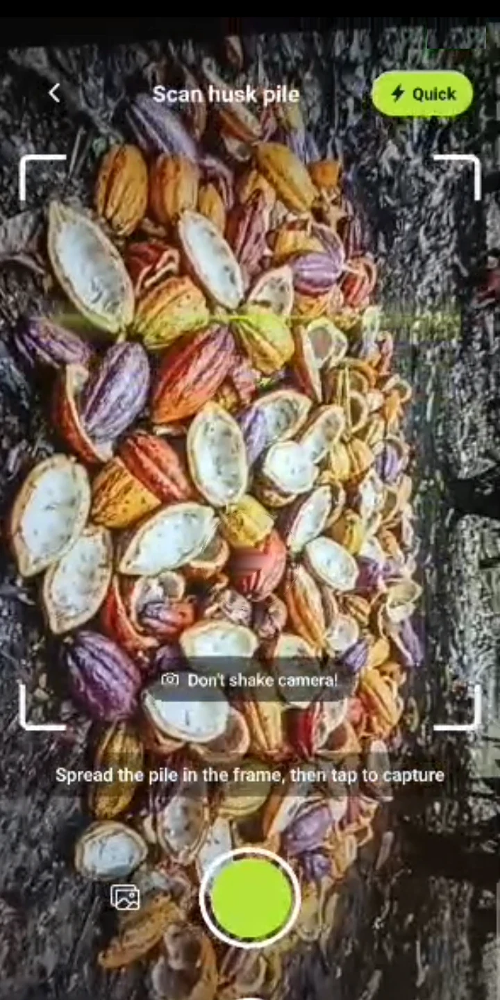
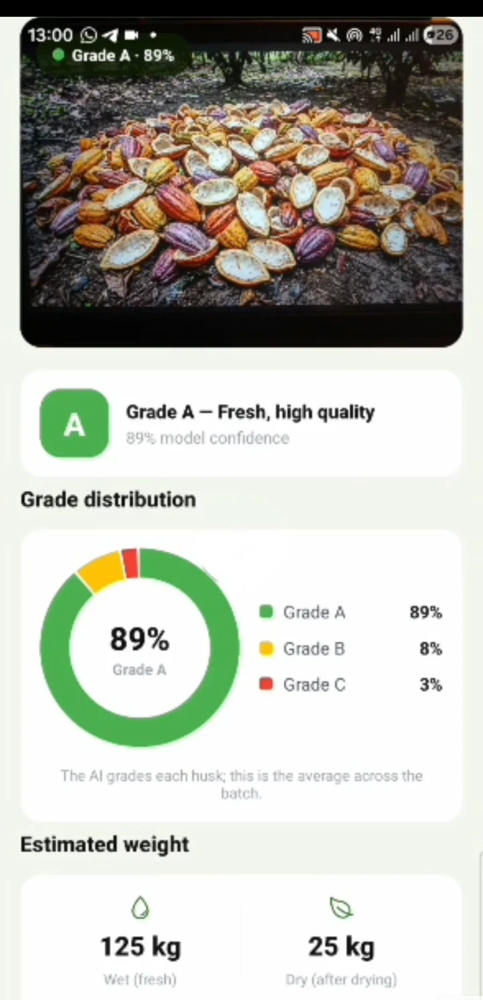
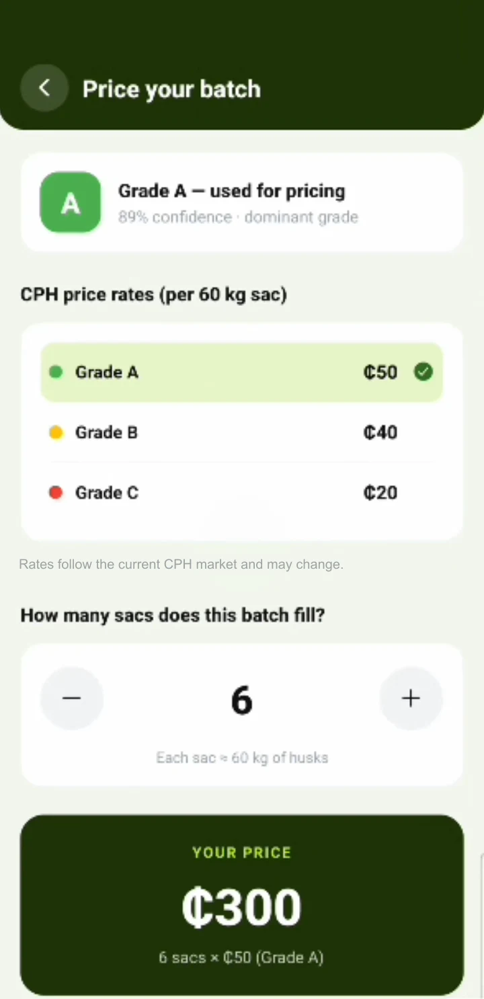
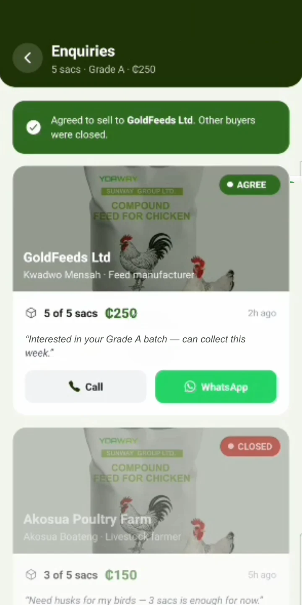
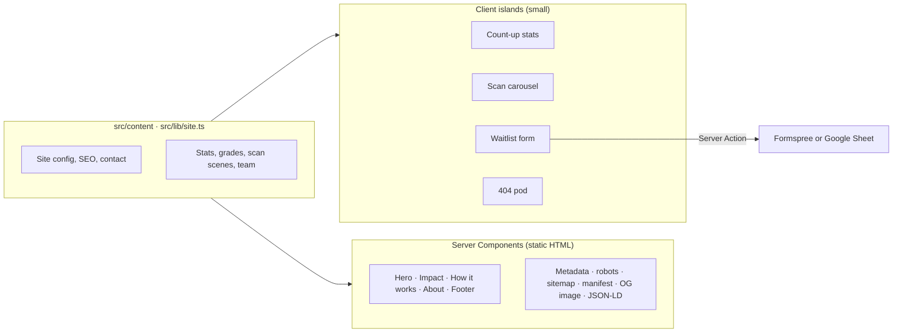

<div align="center">


### AI that helps cocoa farmers turn discarded pod husks into extra income.

**Scan a husk pile → AI grades it → see its value → sell to a buyer.** Built in Kumasi, Ghana.

[**Live site**](https://huskerai.vercel.app) · [LinkedIn](https://www.linkedin.com/company/husker-ai) · [Instagram](https://www.instagram.com/huskertechnologies/) · [Contact](mailto:huskertechnologies@gmail.com)


**🏆 Winner: 2026 Pan African AI Summit Hack-AI-Thon**

</div>

---

## Contents

- [Why Husker AI](#why-husker-ai)
- [The product](#the-product)
- [Impact](#impact)
- [Recognition](#recognition)
- [Team](#team)
- [Engineering: about this repository](#engineering-about-this-repository)
- [Getting started](#getting-started)
- [Roadmap](#roadmap)

---

## Why Husker AI

About **70% of every cocoa pod is husk**. After harvest, smallholder farmers
leave it to rot or burn it on the farm. Ghana has **800,000+ cocoa farm
families**, and almost all of them treat husk as waste.

Meanwhile, companies across Ghana already turn cocoa pod husk into animal
feed, cocoa potash, soap and cosmetics, biochar and organic fertiliser. They
need steady, graded supply. Farmers have the husk, but no simple way to know
what a pile is worth or who will buy it.

**Husker AI connects the two**, with AI on the phone a farmer already owns.

## The product

<table>
  <tr>
    <td align="center" width="25%"></td>
    <td align="center" width="25%"></td>
    <td align="center" width="25%"></td>
    <td align="center" width="25%"></td>
  </tr>
  <tr>
    <td align="center"><b>01 · Scan</b><br/>Point the camera at a husk pile.</td>
    <td align="center"><b>02 · Grade</b><br/>AI classifies each husk A, B or C in seconds.</td>
    <td align="center"><b>03 · Value</b><br/>An estimated price from grade and market rate.</td>
    <td align="center"><b>04 · Sell</b><br/>Buyers make offers. Call or WhatsApp them and sell.</td>
  </tr>
</table>

Built for real farm conditions: it **works offline** and supports **local languages**.

| Grade | Condition | Typical buyers |
| --- | --- | --- |
| **A** | Fresh, clean and dry | Animal feed, cosmetics and skincare |
| **B** | Part fresh, part rotting | Cocoa potash, soap making |
| **C** | Older or partly decomposed | Biochar, organic fertiliser |

## Impact

| Metric | Figure | Basis |
| --- | --- | --- |
| Cocoa farm families in Ghana | **800,000+** | USDA FAS, *Ghana Cocoa Sector Overview* (2025) |
| Share of each pod that is husk | **~70%** | *Heliyon* (2024), cocoa by-products review |
| CO₂ emissions to be avoided (first target) | **~10,000 tonnes** | Husker AI estimate\* |
| Extra income per farmer, per season | **~GH₵ 1,500** | Husker AI estimate\* |

\* Estimates from app prices and published emission factors. They will be
replaced with measured pilot data.

## Recognition

- **Winner, 2026 Pan African AI Summit Hack-AI-Thon**: US$1,000 prize and startup mentorship.
- Featured by YEN News, Modern Ghana, the Business & Financial Times, KNUST and the KNUST College of Science.

## Team

Built at the Kwame Nkrumah University of Science and Technology (KNUST), Kumasi, Ghana.

| | Name | Role |
| --- | --- | --- |
|  | [**Frank Agyare**](https://www.linkedin.com/in/frank-agyare-141269334) | Co-founder & AI/ML Lead |
|  | [**Caleb Antwi**](https://www.linkedin.com/in/calebantwi1) | Co-founder & Mobile App Engineer · **built this website** |
|  | [**Wilhelmina Adjah**](https://www.linkedin.com/in/wilhelmina-adjah-261219330) | Head of Marketing, Research & Partnerships |
|  | **Ayinomba Elijah** | Backend Engineer |
|  | [**Joseph Amankwah**](https://www.linkedin.com/in/joseph-amankwah-3a646926a) | Software Engineer |

---

## Engineering: about this repository

This repository is the **Husker AI marketing website and waitlist**, live at
[huskerai.vercel.app](https://huskerai.vercel.app). The mobile app is developed separately.

### Results

Measured with Google PageSpeed Insights on **mobile** (emulated Moto G Power, slow 4G):

| Performance | Accessibility | Best Practices | SEO |
| :---: | :---: | :---: | :---: |
| **97** | **96** | **100** | **100** |

First Contentful Paint **1.1 s** · Largest Contentful Paint **2.6 s** ·
Total Blocking Time **20 ms** · Cumulative Layout Shift **0**

Following that audit, every small text label was brought up to WCAG AA
contrast and heading levels were fixed.

### Tech stack

| Layer | Choice |
| --- | --- |
| Framework | **Next.js 16** (App Router) with **React 19** and the React Compiler |
| Language | **TypeScript** (strict) |
| Styling | **Tailwind CSS v4** with design tokens and container queries |
| Forms | **Server Actions** with server-side validation |
| Images | `next/image`, AVIF/WebP, blur placeholders, size-aware `sizes` |
| Hosting | **Vercel**, deployed on every push to `main` |

### How it's built



### Engineering highlights

- **Server-first and SEO-driven.** Every page is statically prerendered. Only
  four small interactive pieces run as client components. Metadata, Open Graph
  and Twitter cards, canonical URLs, `robots.txt`, `sitemap.xml`, the web
  manifest, a generated Open Graph image and **JSON-LD** (Organization with
  founders, team and social profiles, plus WebSite) all come from **one
  typed config file**.
- **Computer-vision demo in CSS.** The "Scan in action" section draws
  detection boxes over real farm photos and replays them per scene. Boxes are
  stored as percentages of each photo, and a small layout function reproduces
  `object-fit: cover` cropping, so boxes stay locked to the husks at any
  screen size or aspect ratio.
- **Numbers that never overflow.** Stats use **CSS container queries**
  (`cqi` units), so each figure sizes itself to its own column. The count-up
  animation server-renders the final value, so crawlers and no-JS users see
  real numbers.
- **Optically aligned logo marquee.** Partner logos vary in shape: some have
  a leaf above the wordmark, some have taglines below. Each logo's lettering
  was measured and given a size and offset in `em`, so every company name sits
  on one line at every breakpoint. The marquee is pure CSS: it loops
  seamlessly and pauses on hover.
- **Real product, real screens.** App screenshots went through an image
  pipeline (Node and `sharp`) that reverses a screen recorder's semi-transparent
  play overlay mathematically, rebuilds the covered pixels, and removes the
  status bar and watermarks.
- **Built for budget phones.** Images are sized per device, using exact
  `sizes` for zoomed photos so they stay sharp on low-end Android. There's no
  heavy JS, the mobile menu works **without JavaScript** (`<details>`), and it
  installs as a PWA.
- **Accessible by default.** Semantic landmarks and headings, labelled
  controls, keyboard support, `prefers-reduced-motion` respected by every
  animation, and contrast checked across the page.
- **Waitlist that respects people.** Server-side validation, a spam
  honeypot, privacy policy consent (Ghana Data Protection Act, 2012) and a
  pluggable destination: Formspree or Google Sheets, via one environment
  variable.
- **Delightful details.** A branded, interactive 404 page features a lost
  cocoa pod whose eyes follow your cursor.

### Project structure

```
src/
├── app/
│   ├── layout.tsx              # Root layout, site-wide metadata, JSON-LD
│   ├── page.tsx                # Home page
│   ├── privacy/page.tsx        # Privacy policy
│   ├── not-found.tsx           # Interactive 404
│   ├── actions/waitlist.ts     # Waitlist Server Action
│   └── robots.ts · sitemap.ts · manifest.ts · opengraph-image.tsx · icons
├── components/
│   ├── home/                   # Hero, Impact, HowItWorks, AppTour, ScanDemo, ScanCarousel, Audiences, About, Waitlist
│   ├── navbar.tsx · footer.tsx · phone-mockup.tsx
│   └── count-up.tsx · lost-pod.tsx · json-ld.tsx
├── content/                    # Copy and data: impact, how-it-works, app-tour, audiences, team
├── assets/                     # Optimised images: app screens, logos, team, photos
└── lib/site.ts                 # Single source of truth: name, URL, contact, social, sitemap routes
docs/                           # Waitlist setup guides (Formspree, Google Sheet)
```

## Getting started

Requires **Node.js 20.9+**.

```bash
git clone https://github.com/caleboss20/HuskerAiwebsite.git
cd HuskerAiwebsite
npm install
cp .env.example .env.local
npm run dev
```

Open [http://localhost:3000](http://localhost:3000).

| Script | What it does |
| --- | --- |
| `npm run dev` | Start the development server |
| `npm run build` | Create a production build |
| `npm start` | Serve the production build |
| `npm run lint` | Run ESLint |

### Environment variables

| Variable | Required | Description |
| --- | --- | --- |
| `NEXT_PUBLIC_SITE_URL` | Production | Public URL with no trailing slash. Drives canonical URLs, Open Graph, `robots.txt` and the sitemap. |
| `WAITLIST_WEBHOOK_URL` | Production | Where sign-ups are sent as JSON. See [Formspree setup](docs/waitlist-formspree.md) or [Google Sheet setup](docs/waitlist-google-sheet.md). In development, sign-ups are logged to the terminal if unset. |

### Editing content

Content lives in plain TypeScript, separate from layout:

| File | Controls |
| --- | --- |
| `src/lib/site.ts` | Name, description, contact email, social links, sitemap routes |
| `src/content/impact.ts` | Stats with sources, and the company logo marquee |
| `src/content/app-tour.ts` | The four app steps and their screenshots |
| `src/content/how-it-works.ts` | Grades and scan-demo scenes (photos and detection boxes) |
| `src/content/team.ts` | Team members, photos and LinkedIn links |

## Roadmap

- [x] Marketing site with SEO, PWA and a waitlist
- [x] Real app screens and computer-vision demo
- [ ] Connect waitlist to Formspree or Google Sheets in production
- [ ] Custom domain
- [ ] Pilot results to replace estimated impact figures
- [ ] USSD and SMS access for keypad phones, plus a Husk Agent programme

---

<details>
<summary><b>Credits and licences</b></summary>

- "Cacao black pod rot" by Scot Nelson, Wikimedia Commons, **CC0**.
- "Cocoa pods 001" by Otuo-Akyampong Boakye, Wikimedia Commons, **CC BY-SA 4.0**.
- Company logos are the property of their respective owners and are shown to
  illustrate Ghana's cocoa-husk value chain.

</details>

<div align="center">

**© 2026 Husker AI** · Kumasi, Ghana · [huskertechnologies@gmail.com](mailto:huskertechnologies@gmail.com)

All rights reserved.

</div>
